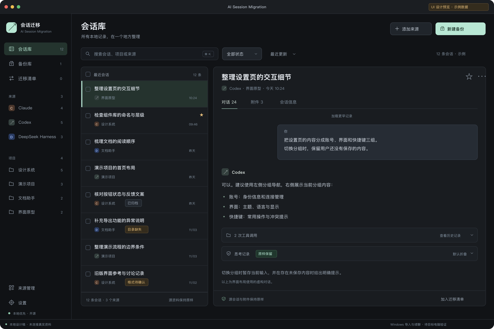

# AI Session Migration

面向 Claude、Codex 与 DeepSeek Harness 的开源桌面会话查看、管理、备份和迁移工具。

产品目标是可安装、可双击启动的图形化客户端。用户通过界面选择资料、查看历史、管理迁移列表、创建备份、检查结果和准备目标电脑的数据，无需手动运行脚本命令。

当前阶段：GUI 方案已获批准，已完成首轮 UI 视觉稿与可点击设计预览。**原生图形客户端尚未实现，当前没有可供安装的 GUI 版本；三来源真实资料尚未接入该预览，Windows 原生导入和续聊尚未验证。**

[查看 UI Design 01](design/README.md) · [首次启动](design/04-welcome.png) · [备份向导](design/02-backup.png) · [结果页](design/03-results.png)

## 项目边界

本仓库只负责会话查看、管理、备份和迁移。Claude 账号状态清理工具继续保留在独立仓库 [claude-account-reset](https://github.com/ForceMind/claude-account-reset)，两者独立发布。

已经过验证的 Claude/Codex 迁移引擎保存在 `internal/migration-engine/`，作为图形客户端的内部基础。它不构成本项目的用户操作界面。原引擎支持只读源资料、在线快照标记、加密备份、归档校验及部分失败续接；其测试使用合成资料，不携带任何真实用户记录。

## 图形客户端的首版方向

- 识别三种客户端的本地资料，按来源和项目浏览会话。
- 查看正文、工具记录和附件，并区分原始日志、缓存及不支持的格式。
- 搜索、筛选、选择、标记及组织待迁移会话，不直接删除原始会话。
- 通过按钮创建备份、导出迁移包、查看进度、验证结果与遗漏。
- 保留现有 thinking 和完整事件；登录材料单独保护，目标电脑重新登录。
- 分开显示在线快照、应用退出后的备份、原生导入及真实续聊的验收状态。

完整迭代与验收见 [图形客户端方案](docs/GUI-PLAN.md)。源资料和备份不上传服务端，不随源码发布。

## 开发状态

| 范围 | 状态 |
| --- | --- |
| 独立仓库与既有引擎保全 | 已准备 |
| Claude/Codex 引擎的合成测试 | 可在开发环境运行 |
| DeepSeek Harness 存储格式调查 | 已确认日志、项目注册表与附件的独立职责 |
| UI 设计与可点击预览 | 已提供，使用示例数据，等待视觉评审 |
| 原生图形化查看、管理、备份界面 | 沿已批准方案实施；当前先完成 UI 设计 |
| Windows 原生导入、兼容转换和真实续聊 | 后续在目标机验证 |

## 开源与隐私

采用 MIT License。仓库只包含通用源码、合成测试和文档；禁止提交真实会话、附件、密钥、私有配置或机器专属报告。贡献需明确支持范围、源资料写入边界和实际验证结果。
