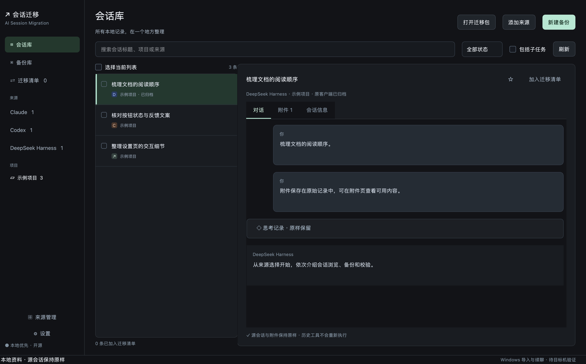

# AI Session Migration

面向 Claude Code、Codex 与 DeepSeek Harness 的开源本地桌面会话查看、管理、备份与导入工具。

**0.4.3** 支持在导出选择页通过「查看详情」预览所选会话正文。项目选择页提前显示随包文件数量与预计体积，导出前再次估算实际空间需求。会话库与 Claude 历史在窄窗口可通过「查看详情」切换，展开和返回保留当前选择。

**0.4.2 源码版**统一了「从移动硬盘恢复」的项目与会话预览。将项目加入恢复计划后，可在确认页查看项目文件或 Git 改动、会话冲突及目标备份位置。确认后依次恢复项目、导入会话。批次结果可从「操作记录」重新打开，并链接各自的回执。

**0.4.1 源码版**在首页提供本机导出、移动硬盘恢复及 Claude 历史与接手三个入口。在旧电脑选择「扫描本机会话」，按项目或逐条勾选，依次确认项目文件、Claude 稿件和移动硬盘保存位置。Claude 阅读器同时显示会话列表、只读原文和接手稿。导出及恢复回执从「操作记录」进入。

在已安装项目依赖的 Windows 仓库中，可用 PowerShell 启动源码版。

```powershell
$env:PYTHONPATH = (Resolve-Path src).Path
.\.venv\Scripts\python.exe -m ai_session_migration
```

**0.4.0 本地候选版**将原样加密保全和经过账号检查的迁移 ZIP 分开。Codex 与 DSH 可原生导入，Claude 在工具内阅读原文和接手稿。每个共享项目可选择随包带文件、从 Git 获取指定提交或关联已有目录。[会话与项目迁移实施方案](docs/PORTABLE-MIGRATION-PLAN.md)

**0.3.1 本地候选版新增「历史与接手」**：在同一个客户端浏览编号 Claude 阅读版，按项目、编号或正文搜索，逐条查看消息全文与原文物理行号，预览、编辑和复制已整理接手稿，也可用勾选消息生成带出处的摘录。该入口只读，不写 Claude 账号目录或索引；用户在新账号新会话中手动粘贴发送。[历史与接手操作说明](docs/HISTORY-HANDOFF.md)。现有 Codex / DSH 本机资料及迁移包浏览入口保留。私人阅读版、接手稿与本地来源配置不随公开源码或通用安装包分发。

[软件官网](https://ai-session-migration.pages.dev/) · [Windows 0.4.3 预览版](https://github.com/ForceMind/ai-session-migration/releases/tag/v0.4.3) · [macOS 0.3.0 预览版](https://github.com/ForceMind/ai-session-migration/releases/tag/v0.3.0) · [官网发布说明](docs/WEBSITE.md)

**0.3.0 恢复中心（预览版）**：选择备份总目录，按会话、项目文件、应用资料、数据库、历史版本、快照、密钥和软件分类查看。支持搜索、分页与文件/文件夹/整组勾选；先备份目标并预览新增、跳过或阻止，再恢复和逐项回读，已有资料不覆盖。历史工具指令只展示，不执行。

从「从移动硬盘恢复」选择备份总目录，或进入「浏览其他备份文件」。选中分类后点「索引当前组」，勾选资料，指定独立恢复目录和私密目标备份位置，再点「预览文件恢复计划」。核对后确认明文目标备份提示并恢复。含迁移 ZIP 的批次可点「打开该批次的迁移包」。恢复记录可复核备份与文件内容，也可仅撤销本次创建且未被用户修改的文件。

完整保全和差异包的引用会按内容校验后读取，不必先解密整份大 ZIP 到本机。文件名不适合 Windows 时安全编码并在恢复记录中保留映射；符号链接恢复为描述文件，不跟随链接。未保存原文件名的旧失败对象明确显示为原始对象提取。Mac 应用资料、数据库和凭据副本不代表 Windows 原生登录、运行环境或续聊已恢复。密钥只显示文件名和格式，不显示正文。

[0.3.0 预览版下载](https://github.com/ForceMind/ai-session-migration/releases/tag/v0.3.0)提供 Mac 与 Windows 双击客户端、[通用图形操作说明](docs/GUI-0.3.0-Guide.txt)和 SHA-256 校验值。源码构建检查见[完整 CI](https://github.com/ForceMind/ai-session-migration/actions/runs/42198293965)。合成验证不等于真实 Windows 迁移验收；私人备份与密钥不属于公开仓库。

从源码运行 Windows 批量原生恢复，可使用 `tools\windows-restore.cmd`。向导生成项目预览、验证样本、备份并分批恢复，结束时登记 Codex 项目并保存账号范围审计。 [Windows 原生恢复操作说明](docs/WINDOWS-RESTORE.md)

**0.2.0 已实现 GUI 原生导入。** 通过界面打开迁移包、选择会话、映射目标项目、预览冲突、完整备份目标资料后恢复。用户无需安装 Python 或运行脚本命令。真实 Windows 资料导入、跨账号/组织/供应商兼容及真实续聊仍等待用户目标电脑验证。



原有深色三栏设计、历史与附件预览、thinking/工具记录折叠、搜索标记、迁移清单、加密备份与实际回读均保留。源会话和源 thinking 不改写，历史中的指令不执行。

## 在新电脑使用

以下步骤以 0.4.3 为准。

1. 双击本工具。Windows 完整解压并保留 `_internal`，再打开 `AI Session Migration.exe`。
2. 点击「从移动硬盘恢复」，选择备份目录或打开 ZIP。查看 ASMB 保全时使用另存的恢复密钥。
3. 核对这份备份的内容，点击「选择要恢复的项目」。为每个项目选择随包文件、指定 Git 提交或已有目录。随包文件和 Git 项目加入恢复计划后，返回备份摘要。
4. 点击「选择会话并核对恢复计划」，勾选 Codex 和 DSH 会话。只恢复项目时可保留空的会话选择。选择目标资料和备份位置，在同一确认页核对会话明细、项目变更及备份位置。有受阻项时先修正目录或调整选择，再重新预览。
5. 退出参与恢复的客户端后，确认目标备份位置并开始导入。工具先备份并核对目标，再发布已经读回验证的独立副本。结果页可按记录查验和撤销。
6. Claude 会话可直接从备份摘要打开，也可在会话选择中点击「阅读所选 Claude 会话」。核对原文后复制接手稿，在 Claude 中打开相应项目，新建会话并手动粘贴发送。

异常退出后，可在「操作记录 → 打开会话恢复记录」中选择备份目录的 `导入结果.json`，检查并恢复。撤销会保留导入副本。若目标已有新对话，客户端会停止自动撤销以保护后续资料。

## 三种来源的支持范围

| 来源 | 原生恢复范围 | 兼容与边界 |
| --- | --- | --- |
| Claude | 在迁移工具内只读浏览本地历史和接手稿 | 支持编号 Markdown 和新版迁移包。Claude 原生导入、侧栏登记及旧计划续写入口均已关闭 |
| Codex | 原生 threads、项目关系、分页 turns/items/投影状态、可用 rollout 和附件 | 只插入新会话，保留既有行；需目标客户端初始化相容数据库，不执行包内 SQL。跨独立 SQLite 目录的目标配置暂不支持，会明确阻止 |
| DeepSeek Harness | v4 原始日志、内容寻址附件、workspace v2 的项目关系/归档/置顶 | 按上游路径编码及独立头帧契约映射目标 cwd，其他物理代际保留在原包；显示缓存由原客户端重建。未知活动格式不假造导入 |

原样加密保全保留已有日志和 thinking。迁移副本先处理已知账号字段并校验引用和偏移。项目工作文件通过「准备项目」单独恢复，可复核冲突和目标备份。

目标机使用自己的登录。新导入的 Codex 索引采用只读和询问权限，未完成 turn 标记为中断。账号、供应商和模型续聊以目标客户端验证为准。

## 备份与恢复保护

- 同 ID 冲突保留目标，不覆盖现有对话。包内同 ID 多来源记录需明确选择一份；同一记录的物理日志按其主副本恢复，其他原始副本保留在源包，不自动合并。
- 导入前完整备份实际参与导入的目标目录，逐文件 SHA-256 回读通过后才开始恢复副本。此目标 ZIP **未加密，可能包含目标机凭据和其他私密资料**，必须私密保管。
- 在独立目录完成恢复、数据库约束/既有行保持检查、历史和 thinking 回读；目标在预览后或发布前发生变化即停止。
- 保留原目标目录、完整备份、暂存/撤销副本与持久化恢复记录，不自动清理。发布阶段按安全边界完成；失败能自动恢复时回读核验，不能恢复时保留副本并报告。
- 目标资料中的符号链接、目录联接、特殊文件、未知格式/不相容模式会阻止完整备份或导入，不静默跳过。

会话导出按项目选择工作文件或 Git 版本。来源仍运行时记录逐文件、逐库的快照范围。接手稿默认复用已有内容，选择生成时会先确认模型服务和发送内容。

## 构建与验证状态

0.4.3 Windows x64 本地双击版通过成品离屏验收。测试使用三来源合成资料，覆盖加密保全、项目冲突、Codex 与 DeepSeek Harness 导入及回读、Claude 只读接手和撤销。原生回归 156 项中 153 项通过，另外 3 项需要 Windows 创建符号链接的权限。

macOS DMG 需在 macOS 上用 `tools/build_macos_release.py --dist <新输出目录> --work <构建目录>` 构建，并从只读挂载的 DMG 运行合成验收。真实迁移验收还需可用的测试备份及目标账号，在目标客户端验证导入后的续聊，并用选定的模型服务验证 Claude 接手稿生成。

0.2.0 已完成：35 项核心与原生控件测试在 Mac 本地及完整 Linux/Windows CI 通过；包含三来源隔离导入、GUI 向导确认门槛、冲突跳过、目标变动、失败恢复、强制中断后的持久化恢复、撤销保护、源字节保持和 Codex 原生关联/偏移。Mac 打包程序以 Cocoa 原生启动，Windows 打包 EXE 在 offscreen 合成环境中运行；两者都完成完整目标备份、三来源导入回读、重复 ID 跳过与撤销，见[最终 CI](https://github.com/ForceMind/ai-session-migration/actions/runs/41967157011)。

资格代码为 `ea3ef02ada8eb39027b935e670643c19333449eb`；Mac 构建与该提交的运行时代码完全相同（后者增加恢复测试）。最终分发包和本地 SHA-256 记录随客户端交付。原生客户端列表显示、个人 Windows 资料导入及真实续聊未验证，不能把本工具的历史回读等同于原客户端验收。

Mac 面向 Apple Silicon、macOS 14.4+，使用本地临时签名，尚未 Apple 公证。Windows x64 无可信发布签名。CI 合成资料与原生控件测试不代替个人设备上的原客户端显示、真实导入和续聊验收。浏览器未验证；本应用不依赖浏览器。

## 开源与隐私

独立仓库 [ForceMind/ai-session-migration](https://github.com/ForceMind/ai-session-migration) 采用 MIT License，Qt for Python 等依赖按随包许可证分发。软件公开分发使用通用代码和合成资料。生成接手稿时，按界面确认的模型服务发送选中的对话文本。

账号痕迹清理工具保留在独立仓库 [claude-account-reset](https://github.com/ForceMind/claude-account-reset)，两者独立发布。历史引擎保留在 `internal/migration-engine/`，不是用户操作界面。[已确认的 UI 设计](design/README.md)继续保留。
