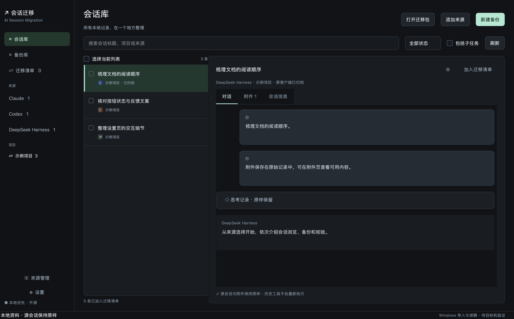

# AI Session Migration

面向 Claude Code、Codex 与 DeepSeek Harness 的开源本地桌面会话查看、管理、备份与导入工具。

**0.2.0 已实现 GUI 原生导入。** 通过界面打开迁移包、选择会话、映射目标项目、预览冲突、完整备份目标资料后恢复。用户无需安装 Python 或运行脚本命令。真实 Windows 资料导入、跨账号/组织/供应商兼容及真实续聊仍等待用户目标电脑验证。

原有深色三栏设计、历史与附件预览、thinking/工具记录折叠、搜索标记、迁移清单、加密备份与实际回读均保留。源会话和源 thinking 不改写，历史中的指令不执行。

## 在新电脑使用

1. 安装并初始化对应原客户端；Codex 需生成相容的状态和分页历史数据库。正常退出原客户端及其后台任务。
2. 双击本工具。Windows 包需完整解压并保留 `_internal`，再打开 `AI Session Migration.exe`；Mac 打开 DMG 内的 `.app`。
3. 点击“打开迁移包”，选择 ZIP、ASMB 或旧版 ENC；加密包按界面选择单独保存的恢复密钥。
4. 在包内勾选会话，点击“导入到本机”。选择目标资料目录，将原项目映射到目标机已有项目文件夹，并选择私密的目标备份位置。
5. 点击“预览冲突”，检查“新增 / 跳过 / 阻止”。同 ID 会话默认跳过，保留目标原记录；可返回重新选择，不自动合并、覆盖或改号。
6. 确认目标客户端已退出、理解完整备份未加密后，点击“备份目标并导入”。先完整备份并回读，后在独立副本恢复并核验，再发布。
7. 结果页可查看备份、恢复记录，或在目标未产生后续变化时撤销。之后由用户打开原客户端验证显示和续聊；本工具不发送模型请求。

异常退出后，可在“导入记录 → 打开恢复记录”中选择备份目录的 `导入结果.json`，检查并恢复。撤销会保留导入副本；若目标已有新对话，拒绝自动撤销，保护后续资料。

## 三种来源的支持范围

| 来源 | 原生恢复范围 | 兼容与边界 |
| --- | --- | --- |
| Claude | 本地 Claude Code 项目日志、会话所属附件；有原始索引时可恢复 Desktop Code 索引 | 可选指定**目标账号下 `local_*.json` 所在的索引容器**，不复用源账号目录；旧包缺索引时需重新导出或仅恢复 Code 日志。普通云端聊天不属于本地导入接口 |
| Codex | 原生 threads、项目关系、分页 turns/items/投影状态、可用 rollout 和附件 | 只插入新会话，保留既有行；需目标客户端初始化相容数据库，不执行包内 SQL。跨独立 SQLite 目录的目标配置暂不支持，会明确阻止 |
| DeepSeek Harness | v4 原始日志、内容寻址附件、workspace v2 的项目关系/归档/置顶 | 按上游路径编码及独立头帧契约映射目标 cwd，其他物理代际保留在原包；显示缓存由原客户端重建。未知活动格式不假造导入 |

导入只改目标副本中的必要路径和索引字段；thinking、正文、事件 ID、签名等保留。结构化本地附件路径按可识别字段映射，历史正文中的旧路径不作全局替换。项目工作文件不写入，需用户自行准备目标项目；源包中的项目副本继续保留。

不导入源登录材料、远程连接、Goals、队列或执行配置。新导入的 Codex 索引采用只读/询问权限基线，未完成 turn 标记为中断；Claude Desktop 索引采用默认权限。恢复历史不能证明账号、供应商或模型允许继续该历史。

## 备份与恢复保护

- 同 ID 冲突保留目标，不覆盖现有对话。包内同 ID 多来源记录需明确选择一份；同一记录的物理日志按其主副本恢复，其他原始副本保留在源包，不自动合并。
- 导入前完整备份实际参与导入的目标目录，逐文件 SHA-256 回读通过后才开始恢复副本。此目标 ZIP **未加密，可能包含目标机凭据和其他私密资料**，必须私密保管。
- 在独立目录完成恢复、数据库约束/既有行保持检查、历史和 thinking 回读；目标在预览后或发布前发生变化即停止。
- 保留原目标目录、完整备份、暂存/撤销副本与持久化恢复记录，不自动清理。发布阶段按安全边界完成；失败能自动恢复时回读核验，不能恢复时保留副本并报告。
- 目标资料中的符号链接、目录联接、特殊文件、未知格式/不相容模式会阻止完整备份或导入，不静默跳过。

会话导出仍可选包含 cwd 工作文件，排除 Git 元数据、依赖缓存和独立凭据；不是整机或完整开发环境备份。来源仍运行时为在线快照，最终冷备份仍由用户暂缓。

## 构建与验证状态

0.2.0 已完成：35 项核心与原生控件测试在 Mac 本地及完整 Linux/Windows CI 通过；包含三来源隔离导入、GUI 向导确认门槛、冲突跳过、目标变动、失败恢复、强制中断后的持久化恢复、撤销保护、源字节保持和 Codex 原生关联/偏移。Mac 打包程序以 Cocoa 原生启动，Windows 打包 EXE 在 offscreen 合成环境中运行；两者都完成完整目标备份、三来源导入回读、重复 ID 跳过与撤销，见[最终 CI](https://github.com/ForceMind/ai-session-migration/actions/runs/41967157011)。

资格代码为 `ea3ef02ada8eb39027b935e670643c19333449eb`；Mac 构建与该提交的运行时代码完全相同（后者增加恢复测试）。最终分发包和本地 SHA-256 记录随客户端交付。原生客户端列表显示、个人 Windows 资料导入及真实续聊未验证，不能把本工具的历史回读等同于原客户端验收。

Mac 面向 Apple Silicon、macOS 14.4+，使用本地临时签名，尚未 Apple 公证。Windows x64 无可信发布签名。CI 合成资料与原生控件测试不代替个人设备上的原客户端显示、真实导入和续聊验收。浏览器未验证；本应用不依赖浏览器。

## 开源与隐私

独立仓库 [ForceMind/ai-session-migration](https://github.com/ForceMind/ai-session-migration)，采用 MIT License；Qt for Python 等依赖按随包许可证分发。仓库只含通用代码、合成测试、文档和合成截图；真实会话、附件、密钥与机器专属报告不随源码发布。资料不上传服务端。

账号痕迹清理工具保留在独立仓库 [claude-account-reset](https://github.com/ForceMind/claude-account-reset)，两者独立发布。历史引擎保留在 `internal/migration-engine/`，不是用户操作界面。[已确认的 UI 设计](design/README.md)继续保留。
